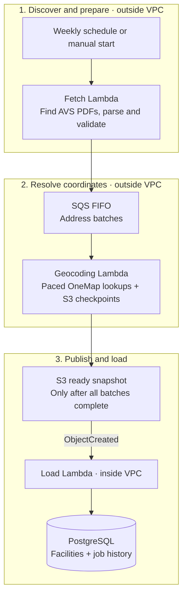

# Facility ingestion for verified discovery

Proposed design, refined 2026-10-27 against the [team document's Facility Map section](https://docs.google.com/document/d/1Gte1t8mkewNT-KRhdyo4M8hTB33PZF1MurivigU07T0/edit?tab=t.gvoi7r3w1sb0#heading=h.jun0sv177xi1), read in its `C. Facility Map` tab (heading `D. Facility Map`). This describes work to implement; no pipeline is deployed or locally validated by this change. It extends the two-stage sync in [architecture.md](architecture.md), retaining PostgreSQL 16 without PostGIS. Floci is the proposed local AWS test environment, not the source of facility data.

## Use case and completion criteria

An owner must be able to find an AVS-listed vet or pet shop by name, postal code or area, filter by type and distance, inspect its details and verification evidence, and open directions. Ingestion supplies a durable, traceable catalogue for those actions. Browsing reads PostgreSQL; it must not download PDFs or geocode every facility during a user request.

| Requirement in the linked Facility Map section | What this design must deliver |
| --- | --- |
| AVS records → parse → validate → geocode → facilities | Two source-specific parsers, complete source snapshots, persisted coordinates and a repeatable database loader |
| Singapore map, list and vet/pet-shop filter | Active facilities with stable IDs, `facility_type` and nullable WGS84 coordinates; unlocated records remain in the directory |
| Nearby results using `lat`, `lng`, radius, type and query | Public API filters before pagination; stored coordinates support bounding-box and haversine calculations |
| Search by name, postal code and area | Preserve searchable names, full addresses and six-digit postal codes; distinguish facility text search from OneMap location search |
| Details: address, contacts, licence, source and check date | Preserve each supplied field, represent absent fields honestly, and expose provenance through the API and detail panel |
| Directions from the user's location | UI builds an external maps link using the selected facility's coordinates or address; ingestion does not calculate routes |
| Weekly sync updates checks and deactivates removals | Independent source runs, complete-snapshot loading, source-scoped retirement, last-good-data preservation and failure visibility |
| Integration tests and fresh data before the demo | Fixture-driven source-to-API checks, a deployed smoke test, and a reviewed successful check of both sources before the demo |

The linked plan proposes PostGIS `ST_DWithin`; the later repository decision uses plain coordinates and haversine SQL instead. Preserve the use case and existing OpenAPI parameter names (`lat`, `lng`, `radius_km`, `type`, `q`), rather than introducing PostGIS or a second API contract.

### What already exists

Checked against the working tree on 2026-10-27:

- `backend/facilities/` implements public OneMap **location search** and tests. Facility and sync-audit models, migrations, source-specific PDF parsers, fetch/dispatch, an idempotent SQS geocoding worker, complete-snapshot finalization and transactional database loading now exist. These ingestion handlers have not yet been exercised through Floci; facility list/detail views remain unimplemented.
- The frontend has MapLibre/OneMap tiles, location selection, type/radius filters, facility details and directions. Its default data is fictional and unverified. API mode can fetch `facilities/`, but the backend route is still missing. Its current location-first search does not implement the requested facility-name search.
- The Lambda image, private database network and S3 endpoint already exist in infrastructure code. Ingestion handler code now exists, but the bucket, queue, function configuration, schedules and local Floci bootstrap still need implementation. `config/lambda_handler.py` currently allows only `migrate`, `showmigrations` and `check` management commands.

The detailed [implementation plan](facility-ingestion-implementation-plan.md) remains a proposed runbook. This refinement does not make its commands available or change the agreed architecture. Coordinate the proposed extra geocoding function/queue with the infrastructure owner; the separate hosting decision for interactive location search remains open.

## How one ingestion run works

1. **Start one source check.** A manual invocation or weekly schedule starts `vet` or `pet_shop` with a run UUID and check time. Persist source ownership before dispatching so another start cannot launch a competing run for the same source.
2. **Acquire the evidence.** Fetch the AVS landing page, follow its validated registry PDF link, retain the original PDF and hash, then extract complete records. Reject an empty, incomplete or suspicious parse before geocoding or changing facilities.
3. **Prepare the work.** Normalize records and source keys, reuse cached coordinates for unchanged addresses, and save the expected address batches in S3 before sending queue messages. The fetch invocation then ends.
4. **Resolve addresses over several invocations.** The queued worker makes paced OneMap calls and saves each result. A retry resumes from saved work. A confidently unmatched address is reported as unlocated; throttling or outages keep work pending until recovery or run failure.
5. **Publish one complete snapshot.** Once every expected batch is complete, assemble all registry records, including unlocated ones, and validate again. Write `ready/{source}/{run-id}.json` last. Nothing under `pending/` is loadable.
6. **Apply atomically.** The ready-object notification invokes the private loader. It validates the artifact, rejects duplicate/older runs, upserts current records and deactivates only missing records from that source, in one transaction. The previous catalogue stays visible until commit.
7. **Serve and inspect.** Public facility endpoints read the committed rows. Staff inspect run history, warnings and failures. A failed refresh retains previous data and its original check date; it never appears as a successful fresh check.

For example, if a complete vet snapshot omits one previously listed centre, that centre becomes inactive after a successful load. If the vet PDF instead fails to parse, no vet records change. Neither case changes pet-shop records. A centre present in the PDF but missing coordinates is still active and visible in the unbounded directory.

## Flow



The diagram shows the main data path. Supporting behavior:

- **Status tracking:** run and load events are recorded in PostgreSQL; separate fetch/geocoding status-event projection remains to be implemented.
- **Recovery:** SQS retries failed batches and redrives exhausted work to a DLQ. A periodic reconciliation job repairs missing dispatch, finalization and status delivery.
- **Storage:** S3 retains original PDFs, manifests, checkpoints, geocoding cache and validation reports.
- **Browsing:** Django reads PostgreSQL and serves facilities to the frontend map and directory.


The fetch function needs internet access but no database access. The load function needs database, S3 and Secrets Manager access but no internet. This fits the existing isolated VPC and S3 gateway endpoint; adding a NAT gateway is unnecessary. A normal Lambda outside a customer VPC has internet access; connecting one to a public subnet does not grant it internet access ([AWS networking documentation](https://docs.aws.amazon.com/lambda/latest/dg/configuration-vpc-internet.html)).

Use separate invocations and snapshots for `vet` and `pet_shop`. One failed source must not remove facilities belonging to the other. Run manually first; enable weekly scheduling after the local and AWS smoke checks pass. A schedule invocation is asynchronous; configure both Scheduler delivery failures and Lambda execution failures, which are separate failure paths.

Fetch `start` discovers/parses a source, persists the expected batches and enqueues them. An SQS-triggered geocoding Lambda processes the batches. Fetch `reconcile` repairs missing dispatch/status delivery and stalled runs on a periodic schedule; normal work is driven by the queue. Keep one active run per source and publish only a complete validated snapshot. Source ownership lives in conditional S3 coordination records, since fetch has no database access; the PostgreSQL source lock separately protects loading. After lease expiry, an old worker must not overwrite a new owner's checkpoints or publish its run. If all required geocodes are cached and no batches are needed, fetch calls the same complete-snapshot finalizer directly.

## Sources and extraction

Initial source configuration:

- [Vet centres, 24 July 2026](https://isomer-user-content.by.gov.sg/30/b3586002-98f9-4e32-86d1-1147f6b31a7f/List%20of%20Vet%20Centres%20as%20of%2024.07.2026.pdf).
- [Pet shops, September 2026](https://isomer-user-content.by.gov.sg/30/2a7a9c21-c75a-4402-85c4-af7b4acd0073/List%20of%20Pet%20Shops%20%28Sep26%29.pdf).

The vet PDF was inspected: it contains structured address columns, wrapped names, six-digit postal codes and serial numbers; licence numbers and coordinates are absent from the inspected table. The pet-shop PDF could not be retrieved by the research browser. Inspect its actual columns before implementing that parser or assuming it supplies licence numbers.

Use the stable [vet registry page](https://avs.nparks.gov.sg/outreach/resources/public-registry-of-avs-licensed-veterinary-centres/) and [pet-shop registry page](https://avs.nparks.gov.sg/outreach/resources/public-registry-of-avs-licensed-pet-shops/) as discovery entrypoints. Both pages were inspected on 2026-10-26 and expose a PDF download hyperlink in their main content. Opening a new tab is browser behavior (`target="_blank"`); the fetcher simply resolves the link's `href` and downloads it with HTTP, without browser automation.

At each check, fetch the registry page, find the PDF download link within the registry content, resolve relative URLs, and require exactly one matching registry document. Validate HTTPS and allowed government content hosts, including each redirect, before downloading. Fail with a report if the expected link is absent or ambiguous; do not choose an arbitrary site-wide PDF. Keep the landing-page URL, resolved PDF URL and registry publication date separately from retrieval time. Page footer update dates are not registry publication dates. Hash the downloaded bytes to detect changed content even when the link stays the same. Keep the initial direct URLs above as provenance and an explicit manual fallback, never as a silent substitute for failed discovery. Test link replacement, relative links, ambiguous links and redirects using local HTML fixtures.

Fetch with bounded timeouts, retries, response-size limits and PDF signature checks. Store original bytes and SHA-256 before parsing. Use a deterministic PDF table/text parser, initially evaluating `pdfplumber` against both documents. Preserve column positions and wrapped rows; do not parse by splitting every line on spaces. OCR/Textract is a fallback only if actual documents require it.

Normalize whitespace and placeholder values such as `NIL`; keep postal codes as strings, including leading zeroes. Retain floor and unit in the address. Validate required names, addresses, postal codes, duplicates, serial continuity where applicable and extracted row totals. A partial parse, empty registry or unexplained large count change produces a rejected report and no ready snapshot. Establish count-change limits from the first reviewed baseline, with an explicit reviewed override for legitimate changes.

## Identity and geocoding

Give each facility a stable database UUID. Prefer an actual licence identifier when the source supplies it. Otherwise use a deterministic source key from facility type, normalized name, postal code and full premise/unit address. Never use PDF serial numbers or name alone. Maintain reviewed aliases for corrected names/addresses; otherwise a move or rename creates a new identity and retires the old one. Preserve distinct units at one postal code. Identical rows may collapse only with a report entry.

This requires revising the draft unique `(facility_type, licence_no)` rule in [data-model.md](data-model.md) during implementation: licence number must be optional, and a non-empty source key must be unique per source. Do not manufacture licence numbers.

Geocode postal code first through OneMap, then use the street/block address if needed. Accept only a matching postal/address result within Singapore; ambiguous candidates go to a report. Do not select the first fuzzy result automatically. Store WGS84 latitude/longitude, geocoding status, query, provider and timestamp. Cache successful results in S3 by normalized address and geocoder version; unit variants may share building coordinates. Use bounded concurrency and backoff for timeouts, throttling and upstream errors. Keep OneMap credentials in Secrets Manager in AWS and ignored local environment files locally.

Retain registry rows even if geocoding fails. Unlocated entries remain browsable in the directory, have no map pin and are excluded from bounded radius queries. On a transient failure, retain previous coordinates only when the address is unchanged, with their original geocoding timestamp. Do not reuse old coordinates after an address change.

Cache PDF extraction by hash, but record each successful source check separately. Rechecking unchanged bytes must still update retrieval/check metadata without repeating successful geocoding. Retry unresolved geocoding independently. Do not imply a newly downloaded old publication is a newly issued licence list. Reuse extraction only for the same PDF hash and parser version. A coordinate-only retry does not advance the registry check date unless that run also rechecks the source successfully.

### Facility data contract

The normalized snapshot is an ingestion artifact, not a Django `loaddata` fixture or a public API response. The loader maps its records to `Facility`; serializers then expose the public fields in [openapi/facilities.yaml](openapi/facilities.yaml). Update that contract and frontend adapters together when implementing the additions below.

| Data | Storage and behavior |
| --- | --- |
| Identity | Database UUID plus unique `(source_id, source_key)`; `source_id` identifies the configured registry, while `source` is its display label. Store `facility_type` separately. Preserve IDs on repeat loads and reactivation. |
| Registry details | `name`, full `address`, six-character `postal_code`; optional `licence_no`, `phone`, `email`, `website`. Use null/empty consistently with the API contract; never fill absent values with fictional data. |
| Location | Nullable `latitude` and `longitude`, both present or both absent; geocoding status, provider, query and original resolution time. Unknown hours/emergency capability remain unknown. |
| Verification | Landing-page `source_url`, exact `source_document_url`, nullable `source_published_at`, `last_checked_at`, PDF hash and last applied run reference. Public details need the source and check date; raw artifacts and worker diagnostics stay private. |
| Lifecycle | `active` and last-seen run reference. Absence from a validated complete source snapshot deactivates a row; return in a later snapshot reactivates it. Never physically delete it during sync. |

`last_checked_at` means when the AVS registry was successfully retrieved and validated, applied only after a successful load; it is neither load time nor geocoding time. `source_published_at` means the document's own issue date and may remain unknown. `verification_status: "verified"` means listed in that AVS source as of the displayed check, not independently confirmed open today. Successful geocoding alone never establishes AVS verification. Reviewed fallback data keeps its original provenance/date; sample data stays unverified.

Search `q` against name, full address and postal code; use `postal_code` for an exact-code filter. An area name already in the address can match text search. For another area/landmark, the existing OneMap location selector supplies a search centre for radius filtering; do not invent an area classification from a postal code. The UI must make facility text search and location selection distinguishable and allow type/radius filters to combine with the text query. Contact fields, including email, must reach serializers, frontend types/adapters and details when supplied. Unknown contacts/licence numbers display as unavailable, not as a failed verification.

### Geocoding rate budget and resumability

Make the request budget configurable rather than assuming a published ceiling applies to every account. For a conservative working assumption of 30 requests/minute, initially target 20 requests/minute (one request every three seconds, with no initial burst). Every actual upstream attempt, including fallback queries and retries, consumes the budget. Deduplicate building/postal lookups before requesting and cache successful results persistently. Distance calculations consume no OneMap requests.

Use one active geocoding worker across both registries; independently rate-limiting two workers would double their combined traffic. Serialize scheduled/manual runs using persisted coordination, not merely a process-local lock. If interactive location search shares the upstream quota, its traffic must also fit the combined budget: reserve headroom and coordinate all callers through a shared limiter when needed. Do not assume a separate token grants a separate quota.

On HTTP 429, honor a valid `Retry-After` header; otherwise use bounded exponential backoff with jitter. Persist progress before a deadline and resume only unfinished work. A 429 is a transient upstream state, not evidence that an address is invalid. The current interactive OneMap client collapses non-200 responses into service-unavailable and has no ingestion rate limiter; ingestion needs explicit status/header handling.

At 20 requests/minute, 600 uncached lookups require at least 30 minutes, exceeding a single Lambda invocation. Implement resumable batches for initial ingestion: write a pending manifest with remaining lookups and results in S3, then enqueue bounded batches for the SQS-triggered worker. Each invocation takes a bounded batch sized for its remaining runtime and saves cache/results before returning. Use a persisted lease with expiry and conditional writes for worker coordination, and make checkpoint/retry operations idempotent. Distinguish pending state from `ready/`: only publish the final complete validated registry snapshot after all lookups have a resolved or explicitly reported unlocated status. Transient throttling does not finalize remaining addresses as unlocated. Bound retry duration and fail/report a stalled run while retaining the last good database snapshot.

Local tests inject HTTP 429 and `Retry-After`, advance an injected clock for limiter unit checks, and verify checkpoint/resume and combined source pacing. Live rate-limit behavior still requires a controlled upstream check. OneMap's official workshop material advertises 300 calls/minute for token-based APIs, which differs from the conservative 30/minute assumption; verify the effective account/endpoint quota before increasing configuration ([official workshop presentation](https://www.onemap.gov.sg/apidocs/static/media/OneMap_API_Workshop_Presentation_260825.04f72136081dd249c5ee.pdf)).

## S3 handoff

### Queued geocoding batches

Use an SQS FIFO work queue with a single message group shared by both registries initially. This serializes quota-consuming worker invocations; the worker must still pace individual requests and persist the next permitted request time/cooldown across invocations. FIFO ordering alone does not enforce requests per minute. If higher worker concurrency is introduced later, retain one coordinated upstream quota budget.

One application message references a bounded set of address queries, initially around 10–20, stored in S3. Its payload contains `schema_version`, `run_id`, `source`, `batch_id`, manifest key/version and batch artifact key; do not include entire PDFs or credentials. Configure the Lambda event source mapping batch size to 1 message initially: this is distinct from the number of addresses inside that message. Cache checks happen before requests; fallback attempts also consume budget. Stop before the runtime deadline and checkpoint individual query results.

Persist the expected batch IDs before enqueueing. Check each send result and record dispatch; a reconciler re-enqueues missing work after a crash between S3 and SQS. Duplicate sends and deliveries are safe because completed query/batch results are keyed by run/batch/query ID. A retried batch skips persisted results. FIFO deduplication is useful but is not a substitute for durable idempotency.

Lambda's SQS mapping polls and deletes messages after successful processing; it does not use Lambda asynchronous invocation retries/destinations for these worker failures. Configure SQS visibility timeout for the function runtime plus retry allowance, bounded receive attempts, redrive to a separate work DLQ, and alarms. For retryable failures, persist progress and fail the message so it becomes available again. Honor a persisted cooldown before further requests; when a long cooldown cannot fit within invocation time, defer visibility and return a failed item rather than acknowledging unfinished work. If mapping batch size grows, enable partial batch responses and preserve FIFO failure ordering ([AWS SQS integration](https://docs.aws.amazon.com/lambda/latest/dg/with-sqs.html)).

After writing each durable batch result, check all expected batch IDs, not queue emptiness or delivered-message counts. When every batch is complete, acquire a conditional finalization lease, assemble/validate the complete source snapshot and publish its deterministic immutable ready key. Reconciliation retries interrupted finalization. A work-DLQ message leaves its run incomplete and visible for diagnosis; it must not trigger partial loading or source deactivation. Database events include batch ID, attempts, completed/expected batch counts and work-DLQ failures; the existing load/status function projects these events without giving geocoders database access.

Use one private ingestion bucket with encryption, TLS enforcement and versioning. Suggested keys:

```text
raw/{source}/{sha256}.pdf
pending/{source}/{run-id}.json
coordination/sources/{source}.json
coordination/geocoding-worker.json
cache/geocoding/{address-hash}.json
reports/{source}/{run-id}.json
status/{source}/{run-id}/{event-id}.json
ready/{source}/{run-id}.json
```

Write the complete immutable `ready/` object last, only after validation. Its creation triggers loading; raw PDFs, caches and reports must never trigger it. Include `schema_version`, `parser_version`, `run_id`, source identifier/type, source URL/publication date, retrieval/check time, PDF hash/key, expected record count, validation summary and normalized records. Each record carries its source key, source fields, nullable coordinates and geocoding status. Leave unavailable phone, website, hours and emergency capability unknown.

The loader validates schema, source allow-list, counts, record uniqueness and coordinate ranges again before facility writes. Facility loading only accepts `ready/` keys; a separate status operation accepts validated `status/` events and can update audit tables only. Validate the configured bucket, decode S3 event keys and process every event record; use the event's exact object version so a retry reads the same bytes. Never accept an arbitrary URL or management command from an event.

## Database job status and debugging

Track the entire ingestion lifecycle in PostgreSQL, including failures before a ready snapshot exists. Create a run UUID before discovery and retain it across geocoding batches, status events, S3 artifacts, load attempts and CloudWatch logs. Each source has its own run. A deliberate rerun gets a new UUID and optional `replay_of` reference; transport retries retain the original UUID.

The outside-VPC fetch worker cannot connect directly to private RDS. It writes immutable, schema-versioned status events to `status/`; S3 notifications invoke the existing inside-VPC load handler's status operation. Geocoding status follows the same path. There are three proposed functions: fetch, geocode and load/status. Database status is eventually consistent; S3 checkpoints remain authoritative for scheduling/resumption. Status projection never changes worker leases or publishes facility snapshots.

| Proposed model | Fields and purpose |
| --- | --- |
| `FacilitySyncRun` | Unique `run_id`, source, trigger type, optional `replay_of`, lifecycle status, stage; UTC start/update/last-progress/finish/next-retry timestamps; landing-page/PDF URLs, publication date, PDF hash, parser/schema versions; checkpoint/report/ready S3 keys; last accepted sequence per producer; progress counters; last sanitized error code/message and retryable flag. |
| `FacilitySyncEvent` | Unique event UUID, run foreign key, producer (`fetch`, `geocode` or `load`), producer sequence, stage, event kind, occurrence/receipt timestamps, attempt/invocation ID, sanitized details and artifact keys. Append-only history of attempts, throttling and failures. |
| `FacilitySourceState` | Unique source and latest successfully applied run/check/publication metadata, used for locking and stale-snapshot rejection. |

Run status is `running`, `waiting_retry`, `ready`, `loading`, `succeeded`, `failed` or `superseded`. Stage is `discovery`, `download`, `parse`, `geocode`, `validate` or `load`. Waiting for the next normal batch stays `running`; upstream backoff uses `waiting_retry` with `next_retry_at`. Only a committed facility transaction marks `succeeded`. An older skipped snapshot becomes `superseded`. A successful run may include explicitly reported unlocated facilities; retain a warning count and never label partial registry loading successful.

Record parsed rows, unique geocoding queries, cache hits, completed/pending/unlocated queries, upstream attempts, 429 responses and retries. Loader counters cover inserted, updated, unchanged and deactivated facilities. Keep query counters separate from facility counts because one query may serve several facilities. Emit status on stage changes, completed checkpoints, scheduled backoff and exceptions, rather than on every successful lookup.

Insert each event once by unique ID and project outside-VPC progress only for a newer sequence from that producer. Persist independent fetch/geocode sequences with checkpoints across invocations; never compare a fetch sequence with a geocode sequence. Keep older events as history without regressing current state. If loading starts before fetch status arrives, create the run from validated snapshot metadata. Fetch/geocode events cannot overwrite `loading` or loader terminal outcomes. Insert an event and update its projection in one transaction; duplicate notifications become no-ops.

The loader writes its own events directly to PostgreSQL: commit a load-attempt event before facility writes, then commit success and facility changes together. After rollback, record the error separately, using `waiting_retry` while retries remain and `failed` when abandoned. Repeated stages retain earlier attempt history. Keep full stack traces in CloudWatch, correlated by run/invocation ID; exclude credentials, tokens and raw response bodies from database diagnostics.

Hard timeouts and database outages may prevent status writes. The fetch reconciliation operation must reconcile pending checkpoints and immutable status artifacts, re-emitting missed notifications with the same event IDs. Expired leases/run deadlines produce recovery or terminal failure events. Retain final status artifacts after pending work is finished so projection failures can be reconciled later without reloading committed facilities. Failure destinations and logs cover S3 outages. Show stale progress using `last_progress_at`, expected batch timing and `next_retry_at`; one missed heartbeat does not establish terminal failure.

Initially expose runs/events through staff-only Django admin with source/status/stage filters, elapsed time, last progress, pending work, counters, sanitized errors and artifact keys. Keep diagnostics out of the public facilities API. Database records do not themselves authorize replay.

## Transactional database load

Use the audit models above and a per-source state row. Record the load attempt separately, then in one PostgreSQL transaction:

1. Lock the source state row to serialize overlapping loads.
2. Return successfully if this run is already applied.
3. Ignore snapshots older than the latest applied source check; reject publication regressions unless explicitly approved for restoration.
4. Upsert all source records, preserving stable UUIDs and recording registry provenance.
5. Mark absent facilities inactive only for this source and only for a complete validated snapshot. Missing coordinates do not count as missing registry records.
6. Record counts of inserted, updated, unchanged, deactivated and unlocated rows; mark the run applied and advance source state.

Any error rolls back the full load. Record failure status separately after rollback where possible. The previous successful dataset remains available. Replaying a historical artifact for recovery must be an explicit operation with a new audited run, not an accidental out-of-order event.

S3 delivers notifications at least once, so duplicate handling is required ([AWS S3 documentation](https://docs.aws.amazon.com/AmazonS3/latest/userguide/EventNotifications.html)). Configure bounded asynchronous retries and an SQS failure destination; retain immutable artifacts for diagnosis and replay. Start with loader reserved concurrency 1, while keeping database locking and idempotency for correctness. Log run IDs and counts; alarm on failed runs, failure-queue messages and overdue successful checks per source.

## Local environment with Floci

Implement locally first using the **same backend image, handlers and event/artifact contracts** intended for AWS. Floci supplies local AWS APIs and invokes the workers; the existing PostgreSQL container stores the real facility and audit tables. Start with deterministic AVS/OneMap HTTP fixtures, then perform an opt-in live-source run locally before the AWS rollout. The [implementation plan](facility-ingestion-implementation-plan.md#how-floci-fits-the-implementation) defines the additions, bootstrap order, local acceptance gate and deployment differences. Local provisioning uses boto3; production infrastructure remains CDK.

Use Floci for S3, Lambda, Secrets Manager, SQS and scheduling/event integration; keep the existing real `postgres:16` Compose service. RDS emulation adds little value to testing Django transactions and migrations. Floci documents Docker-backed Lambda execution and locally built image support ([Lambda documentation](https://floci.io/floci/services/lambda/)); verify the exact integrations against a pinned image version before relying on them.

Add a Compose override/profile containing Floci, an HTTP fixture server and a one-shot bootstrap container. Give Floci access to Docker for Lambda execution. Attach spawned Lambda containers to the same named Docker network as PostgreSQL, Floci and fixtures using the selected release's documented network configuration. Pin the Floci image and backend image versions; do not use floating `latest` in repeatable tests.

The bootstrap script creates only ingestion resources: bucket/notification, three Lambda functions from the backend image with different entrypoints, secrets, failure queue, invoke permissions and a FIFO work queue with redrive DLQ/event source mapping, and disabled discovery/reconciliation schedules. It does not emulate the entire CDK application, Cognito or CloudFront. Production CDK and local bootstrap must use the same handler names, environment contract, notification filters and invocation payloads. Verify conditional S3 writes used for leases/checkpoints against the pinned Floci release; an in-memory lock is not an equivalent fallback.

| Setting | Host tools | Lambda containers | AWS |
| --- | --- | --- | --- |
| AWS endpoint | `http://localhost:4566` | `http://floci:4566` on shared network | SDK default, no override |
| Database host | `localhost:5432` | `db:5432` | Private RDS hostname |
| Region | `ap-southeast-1` | `ap-southeast-1` | `ap-southeast-1` |
| Credentials | Local dummy values | Local dummy values | Execution role |
| Source/geocoder URLs | Fixture server | Fixture server Docker hostname | AVS/OneMap |

Use path-style S3 addressing locally. `localhost` within a Lambda container refers to that container, not the host. Avoid logging environment values or using real AWS credentials in the emulator.

Provide two local modes: deterministic fixture PDFs and OneMap responses by default, and an explicit live-source mode for manual checking. Floci emulates AWS services; it does not emulate AVS or OneMap. The default integration test must run without either external service or OneMap credentials.

Local setup sequence:

1. Start PostgreSQL, pinned Floci and the fixture server on the shared network.
2. Build the backend image, apply Django migrations and run the bootstrap script.
3. Invoke fetch with `{"operation":"start","source":"vet"}`; use the same operation with `pet_shop` for the other source. The handler discovers and parses the linked PDF, stores the original and parsed artifacts plus address batches and the complete expected-batch manifest in S3, then dispatches FIFO queue messages. If sending is interrupted, invoke `{"operation":"dispatch","source":"vet","run_id":"<run-id>"}` to resend undispatched batches from the manifest.
4. Let the SQS mapping invoke `facilities.ingestion.handlers.geocode`. The worker checkpoints each postal-code result in S3 and skips saved results on redelivery. The last completed batch writes a full `ready/` snapshot only after every batch is complete; its S3 notification invokes `facilities.ingestion.handlers.load` to update PostgreSQL atomically. Invoke `{"operation":"reconcile"}` to test recovery after that operation is implemented.
5. Wait for the final `ready/` upload to trigger load automatically, then inspect sync audit rows and call the public facilities endpoint.
6. Repeat the run and inject discovery failures, HTTP 429 and duplicate notifications; verify safe recovery without duplicate facilities or unintended deactivation.

Environment contract: fetch reads `FACILITY_SYNC_BUCKET`, `GEOCODE_QUEUE_URL` and optional `GEOCODE_BATCH_MAX_REQUESTS` (default 10). Geocoding reads `ONEMAP_REQUESTS_PER_MINUTE` (default 75), `GEOCODE_CACHE_MAX_AGE_DAYS` (90), and `ONEMAP_SECRET_ARN` or local OneMap credentials. Recovery uses `FACILITY_MAX_RUN_AGE_HOURS` (24); loading uses `FACILITY_MAX_DEACTIVATION_FRACTION` (0.2). `FACILITY_SOURCE_CONFIG`, `FACILITY_FIXTURE_MODE=true` and `ONEMAP_FIXTURE_URL` enable only the explicit local fixture sources. Inside Lambda containers, queue and AWS API URLs use `floci:4566`, not localhost. The local bootstrap and opt-in CDK stack configure functions, event wiring and failure destinations. Production leaves endpoint overrides and fixture mode unset. See [facility ingestion operations](facility-ingestion-operations.md) for run history, recovery, review and AWS acceptance.

## Distance and radius search

Geocoding happens during ingestion and stores WGS84 latitude/longitude. Distance is calculated at search time from those stored coordinates; it consumes no OneMap calls. The search centre comes from device geolocation or a selected OneMap address result. Device geolocation needs no OneMap search; an address search does consume the shared upstream budget.

The existing frontend implementation in `frontend/lib/facility-search.ts` uses haversine distance with Earth radius 6,371 km. For coordinates converted to radians:

```text
a = sin²((lat2 - lat1) / 2)
    + cos(lat1) × cos(lat2) × sin²((lon2 - lon1) / 2)
distance_km = 2 × 6371 × asin(sqrt(clamp(a, 0, 1)))
```

This is straight-line surface distance, not walking/driving distance. Label it accordingly. Proposed API request: `GET /api/v1/facilities/?lat=1.35&lng=103.85&radius_km=5`. Validate coordinates and supported radii. In PostgreSQL, apply a bounding-box prefilter, compute haversine distance, filter to `distance_km <= radius_km`, sort by distance with a stable ID tie-breaker, then paginate. Return the computed distance so the UI uses the same value for sorting and display. Round only for display, not before filtering.

Rows without coordinates remain available in unbounded directory browsing but have no distance or map pin and are excluded from radius searches. A map basemap does not calculate proximity. PostgreSQL numeric columns and SQL trigonometric functions suffice for this bounded registry; PostGIS/GeoDjango is not required. The paginated backend radius query is proposed; the current frontend calculates proximity against already-loaded facilities.

## Implementation and acceptance

Follow the phased [implementation plan and local Floci runbook](facility-ingestion-implementation-plan.md) for proposed files, bootstrap resources, commands and rollout gates.

Both AWS CDK and the Floci bootstrap must configure separate `ready/` and `status/` notification filters on the load function. Add the audit models/migrations and staff admin alongside facility models. The load function writes audit rows directly, so it does not need S3 write permission; fetch writes status artifacts and performs notification reconciliation without database credentials.

Status acceptance checks cover discovery failure before parsing, batch progress, 429 cooldown, duplicate/out-of-order status delivery, load rollback followed by retry success, missing terminal events after timeout, database-outage recovery and staff-only diagnostics. Assert successful status and facility changes commit together, delayed fetch events cannot regress load results, and replaying audit events never repeats facility mutations.

Implement in this order. Paths below identify the affected code, not a requirement to create a separate module for every operation; reuse the proposed layout in the implementation plan only where it helps.

| Order | What needs to be implemented | Files/integration points and completion check |
| --- | --- | --- |
| 1. Source contracts | Parsers and PDF extraction dependency are implemented; reviewed HTML/PDF/OneMap fixtures and parser validation remain | `backend/facilities/ingestion/`; expected records must match reviewed source rows, including units and leading-zero postal codes. |
| 2. Database loader | `Facility`, sync run/event/source-state models and migrations exist; staff admin and transactional loading are implemented | `backend/facilities/ingestion/loading.py` validates the artifact and applies upserts, source-scoped deactivation, audit and source state in one transaction. Reruns preserve IDs; failed loads roll back. Floci execution remains unverified. |
| 3. Fetch and geocode | Allowlisted registry discovery, bounded PDF download, parsing, durable FIFO dispatch, per-query checkpoints, successful-result cache, serialized request pacing, persisted 429 cooldown and complete-snapshot finalization are implemented. Automatic reconciliation remains | `backend/facilities/ingestion/fetch.py`, `dispatch.py`, `geocoding.py` and `finalize.py` are independent of Django startup. Duplicate query and batch deliveries reuse saved results; Floci integration and live OneMap behavior are not yet verified. |
| 4. Local end-to-end path | Pinned Floci, existing PostgreSQL, fixture server, resource bootstrap and integration runner | Proposed Compose override and `scripts/facilities/`. Real queue invocation and ready/status notifications produce correct facilities and audit history; direct handler tests alone do not pass this gate. |
| 5. AWS deployment | Private ingestion bucket, three functions from the backend image, FIFO work queue/DLQ, event mapping, ready/status filters, weekly discovery and recovery schedules, IAM and failure alarms | `infra/` with the infrastructure owner; backend environment examples, image entrypoints and deployment/run instructions. Fetch/geocode have no DB credentials; load reads ingestion objects and accesses DB/secrets. Enable schedules only after AWS smoke checks. |
| 6. Public API | `AllowAny` list/detail views for active facilities, type/text/postal/radius filters, validation, pagination and provenance | Facilities serializers/views/URLs, `docs/openapi/facilities.yaml` and API tests. Return 404 for inactive/missing details; validate paired `lat`/`lng` and require a centre for radius; filter and sort before paginating. |
| 7. Owner flow | Facility-name/postal text search alongside location selection; API filtering; email/contact/provenance fields through types/adapters/details; directions from the selected origin | `frontend/lib/api/services.ts`, `types.ts`, `adapters.ts`, `components/Directory.tsx`, shared client and focused checks. Current `facilities()` loads the catalogue without filters: implement the query contract and handle stale responses. Preserve explicit sample mode; API errors show errors. |

Keep the existing map rendering, device-location handling and directions behavior where they already satisfy the use case. The current directions link lets the external map choose the origin; if an owner has selected a location and expects directions from it, pass that origin explicitly. Do not request location permission during ingestion. A paginated list represents only its returned results: the map/list must agree on which results are shown, rather than silently treating the first page as the full radius result.

At implementation time, update `docs/data-model.md` (optional licence and source identity), `docs/architecture.md` (the agreed deployed sync), `docs/frontend-integration.md`, backend/infra READMEs and environment examples. The older two-stage architecture description and draft licence uniqueness remain planning context until those changes land.

Acceptance scenarios: fixture registry HTML → linked PDF → real Floci fetch invocation → SQS-triggered geocoding batches → final S3 notification → real load invocation → PostgreSQL rows → public API. Assert correct names/units/postal codes, stable IDs on rerun, safe duplicate/out-of-order delivery, source-isolated deactivation, reactivation, parser failure preserving existing rows, loader rollback, ambiguous/missing geocodes, unchanged-source checks and unresolved-geocode retries. Include replaced PDF links, 429 cooldown, checkpoint/resume, competing worker invocations and expired-lease recovery. Radius checks cover known coordinate pairs, boundary inclusion, missing coordinates and filtering before pagination. Test notification delivery and failure destinations on the pinned Floci release; direct handler invocation alone is not sufficient.

Finally run an AWS smoke test for IAM, isolated-VPC connectivity, S3/Secrets Manager endpoints, actual Lambda image startup, discovery/reconciliation scheduling and SQS integration, checkpoint recovery and failure delivery. Local success cannot establish those production properties. Resumable geocoding is part of the initial implementation; tune batch size using measurements without publishing partial snapshots.

Queue-specific checks: duplicate batch delivery, partial dispatch recovery, persisted pacing across worker restarts, work-DLQ failure projection, and finalization only after every expected batch completes. Grant fetch SendMessage, geocode queue-consumer permissions and S3 checkpoint/status/ready access; geocode has no DB credentials. Verify FIFO grouping, visibility changes and redrive on the pinned Floci release and AWS.

## Animal approvals implemented in parser version 2

Pet-shop records carry the six AVS animal-approval codes in a nullable `approved_animals` list. The parser validates the labelled columns and approval markers, and excludes the explicitly labelled revoked-licence section by PDF table position. The field survives parsed artifacts and final snapshots, is validated before loading, and participates in business-field change detection. Legacy artifacts that omit it do not erase current approvals. New parser-version-2 pet-shop records require approvals; veterinarians remain unknown/inapplicable. See the operations guide for migration and reimport commands.
